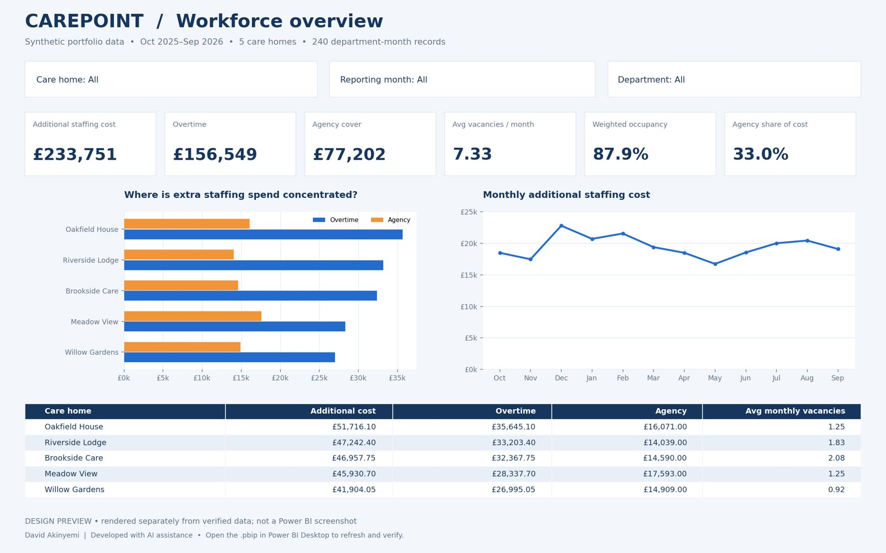

# CarePoint Healthcare Workforce Analytics

**Excel · SQL · Power BI | Synthetic healthcare portfolio project | David Akinyemi**

Where are additional staffing costs concentrated, and do the homes with the most vacancies also spend the most?

CarePoint explores those questions across **five fictional care homes, four departments and 12 months (October 2025–September 2026)**. The 240-row dataset supports cost comparisons, vacancy analysis and practical recommendations for workforce managers.

*Design preview rendered from the verified dataset; not a Power BI screenshot. The native Power BI project is included below.*

## Key findings

| Measure | Result |
|---|---:|
| Total additional staffing cost | **£233,751.00** |
| Overtime | £156,549.00 — 67.0% |
| Agency cover | £77,202.00 — 33.0% |
| Highest-cost home | Oakfield House — £51,716.10 |
| Highest average monthly vacancy count | Brookside Care — 2.08 |
| Highest-cost month | December 2025 — £22,797.40 |
| Lowest-cost month | May 2026 — £16,735.15 |
| Weighted occupancy | 87.9% |
| Home-month vacancy/cost correlation | −0.054 across 60 observations |

Oakfield’s cost pressure and Brookside’s vacancy pressure point to different management questions. The near-zero correlation shows **no clear linear relationship in this sample**; it does not prove that vacancies never affect costs.

## Explore the work

| Component | Files | What it demonstrates |
|---|---|---|
| Power BI | [Open project files](powerbi) · [Opening instructions](powerbi/START_HERE.md) | Two report pages, slicers, KPI cards, cost comparisons, trend and scatter plots |
| Excel | [Download workbook](excel/CarePoint_Workforce_Analysis.xlsx) | Formula-driven dashboard, source-linked charts, monthly summaries and validation |
| SQL | [Queries](sql/CarePoint_Analysis.sql) · [SQLite database](sql/CarePoint.sqlite) · [Verified outputs](sql/verified_results.json) | Grouping, aggregation, reconciliation, ranking and grain-aware calculations |
| Source data | [240-row workforce CSV](data/workforce.csv) · [60-row home-month CSV](data/home_month.csv) | Transparent synthetic inputs and aggregation |
| Analysis | [Full findings and recommendations](docs/Analysis_Report.md) · [Data dictionary](docs/Data_Dictionary.md) | Interpretation, investigation priorities and limitations |
| Walkthrough | [Watch/download the 38-second demo](assets/CarePoint_Desktop_Walkthrough.mp4) | A rendered desktop-style illustration of scrolling, chart inspection and filtering |

The walkthrough is a simulated demonstration made from the verified data, rather than a recording of Power BI Desktop.

## Power BI dashboard

**Page 1 — Workforce overview:** care-home, month and department slicers; cost, vacancy and occupancy cards; overtime/agency comparison; monthly cost trend; care-home table.

**Page 2 — Staffing investigation:** dynamic vacancy/cost correlation, observation count, sickness and cover-hours cards; a home-month scatter plot; department cost comparison; interpretation notes.

### Open the report

1. Choose **Code → Download ZIP** at the top of this GitHub repository and extract it.
2. Open `CarePoint/powerbi/CarePoint.pbip` in an up-to-date Windows Power BI Desktop.
3. Select **Home → Refresh**. The 240-row dataset is embedded, so no local CSV path or data-source login is needed.
4. Clear filters and check that additional cost is **£233,751**. Selecting Brookside should show **£46,957.75** and **2.08** average monthly vacancies.

Keep the report and semantic-model folders beside the PBIP file. A PBIP is a native Power BI project, not a PBIX binary. See [START_HERE](powerbi/START_HERE.md) for details.

**Validation status:** both pages were opened by David in Power BI Desktop on 17 November 2026. Visible headline figures matched the expected results, and the care-home slicer was confirmed to change the results. Static checks covered 39 report/project documents and all visual field references. Other filter combinations and PBIX export have not been comprehensively checked. The right-side Filters pane has no preconfigured page/report filters; use the slicers on the report canvas. Slicer selections are independent between pages.

## Analysis workflow

1. Establish the record grain: one department in one care home in one month.
2. Validate completeness, unique keys and overtime-plus-agency cost reconciliation.
3. Summarise expenditure by care home, department and month.
4. Separate source vacancy counts from budget-minus-actual FTE gaps.
5. Aggregate to home-month level for the scatter plot, and count repeated bed fields once per home/month.
6. Compare findings and propose targeted management investigations.

The delivered Excel workbook uses SUMIF/SUMIFS summaries. Earlier learning exercises used PivotTables and comparative charts. SQL queries are tested against the supplied SQLite database; MySQL/phpMyAdmin users should import the workforce CSV into a table named `workforce` and use a server supporting the CTE queries.

## Recommended management investigations

- **Oakfield:** examine overtime authorisation, rota coverage and department skill mix.
- **Brookside:** investigate vacancy duration, recruitment progress and turnover.
- **Meadow View:** review agency bookings and rates; it has the highest agency expenditure.
- **Workforce reporting:** agree vacancy/FTE definitions and obtain a second year of data before claiming seasonality.

## Data definitions and limitations

- All records are synthetic; the analysis does not describe real patients, employees or care providers.
- Additional cost includes overtime and agency cover, not ordinary salaries.
- Vacancy counts are repeated monthly snapshots. Their annual sum is not a count of distinct unfilled jobs.
- Bed capacity repeats across departments and is counted once per home/month for occupancy.
- Correlation is descriptive, not causal. One year of synthetic data cannot establish recurring seasonality or realised savings.

## Contribution and tools

David performed earlier spreadsheet learning exercises using PivotTables, trend charts, cost comparisons and scatter analysis. The completed workbook, SQL analysis pack and native Power BI definitions were developed with AI assistance; David opened the report in Desktop and checked its results and care-home filtering. The repository documents that distinction so the work can be studied, reproduced and explained accurately.

**Tools:** Excel-compatible spreadsheets, SQL/SQLite, Power Query, DAX and Power BI Desktop. Future learning work includes reproducing the queries and calculations, extending filter testing and refining presentation in Desktop.
