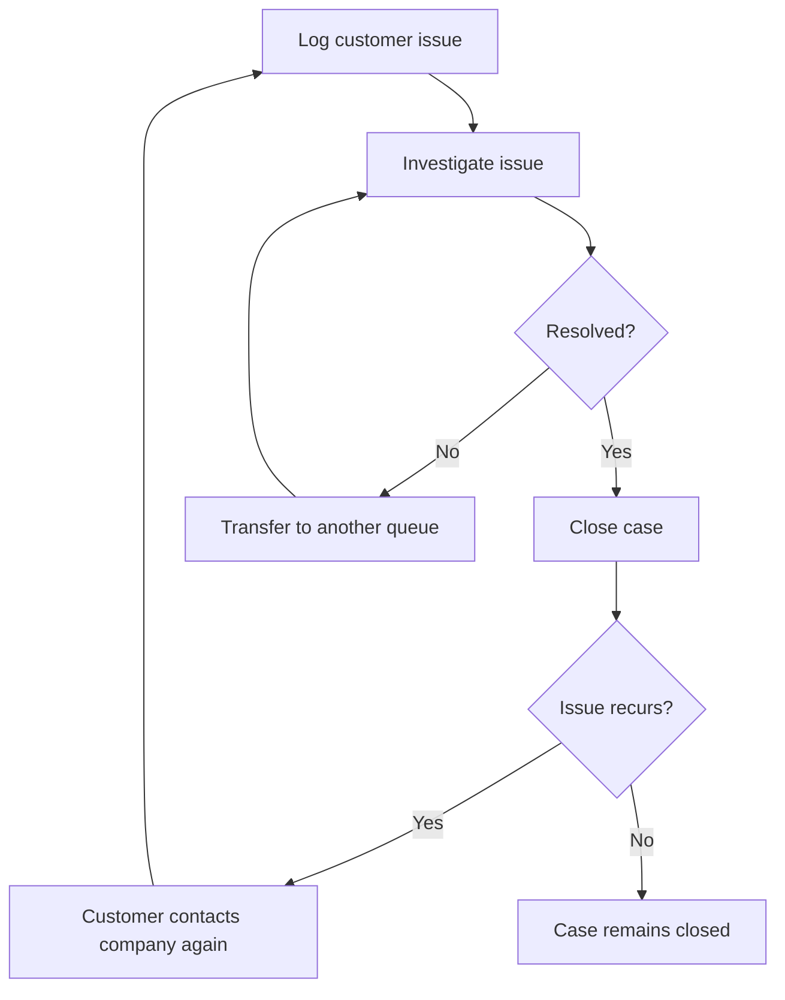
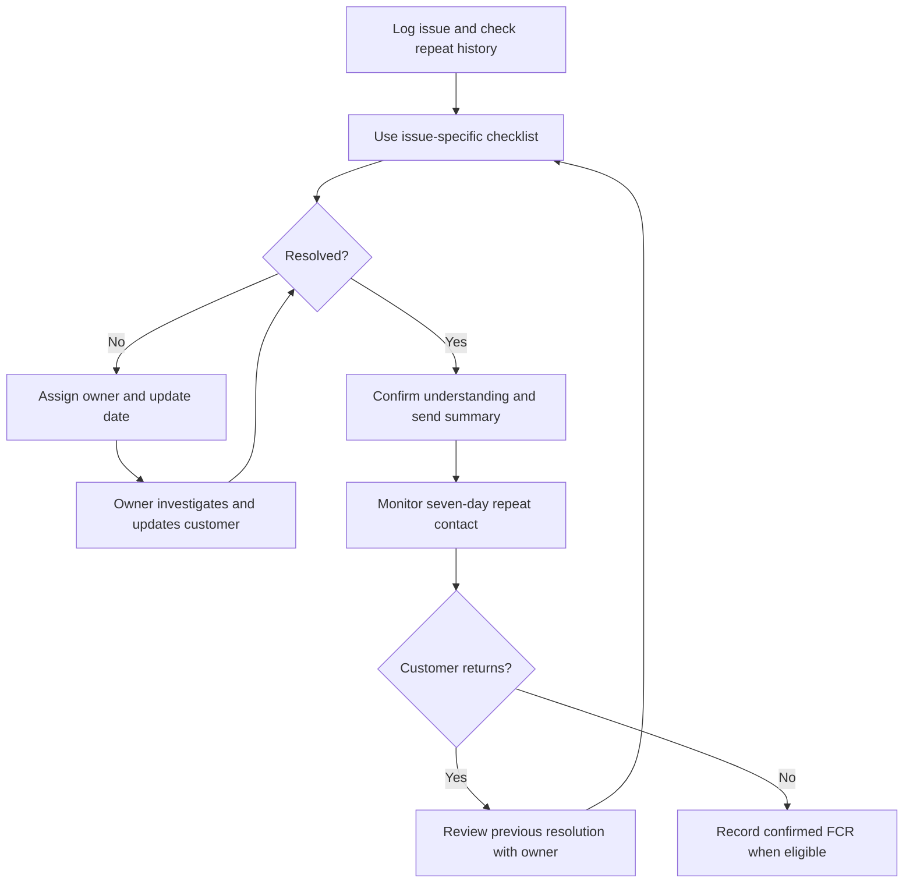

# Process improvement maps

The current process is an assumed baseline for this fictional case study. The future process is a proposal, not an implemented change.

## AS-IS: assumed current process

## TO-BE: proposed future process

## Proposed requirements and acceptance criteria
1. An unresolved pilot case must have an owner and update date before transfer. Verify on sample cases.
2. A returning customer case must show related case history to the agent. Requires an operational customer/case linkage absent from this dataset.
3. A first-contact resolution qualifies as confirmed only after the seven-day follow-up period and zero repeats.
4. Reporting must exclude missing CSAT and email waits from those averages.
5. Filtered case counts and rate denominators must reconcile with exported cases.

Owner, update date and customer history fields require additional system design; they are not fabricated in the historical source.
